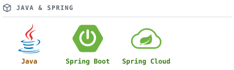
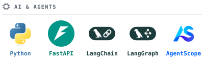

[English](./README.md) · [简体中文](./README.zh-CN.md)

# Hi, I'm CoderBruis 👋

**Java Backend · Distributed Systems · Middleware · AI Agent**

I focus on Java backend development, distributed systems, and middleware, including Kafka, RocketMQ, Dubbo, and Netty. I enjoy reading source code, tracing implementation details, and contributing focused fixes with regression tests.

I'm also exploring AI agent engineering with AgentScope and the LangChain ecosystem, alongside containerized deployment with Docker and Kubernetes.

## Tech Stack

<picture><source media="(prefers-color-scheme: dark)" srcset="./profile/tech-stack/java-dark.svg"></picture>
<picture><source media="(prefers-color-scheme: dark)" srcset="./profile/tech-stack/middleware-dark.svg"></picture>
<picture><source media="(prefers-color-scheme: dark)" srcset="./profile/tech-stack/ai-dark.svg"></picture>
<picture><source media="(prefers-color-scheme: dark)" srcset="./profile/tech-stack/devops-dark.svg"></picture>
<picture><source media="(prefers-color-scheme: dark)" srcset="./profile/tech-stack/web-dark.svg"></picture>
<picture><source media="(prefers-color-scheme: dark)" srcset="./profile/tech-stack/data-dark.svg"></picture>

## Selected Pull Requests

Small, focused improvements to correctness, validation, and resource lifecycles.

| Project | Pull request | Focus |
| :--- | :--- | :--- |
| **Apache Kafka** | [#22722](https://github.com/apache/kafka/pull/22722) | Prevent integer overflow in topic partition validation. |
| **Netty** | [#17093](https://github.com/netty/netty/pull/17093) · [#12254](https://github.com/netty/netty/pull/12254) | Validate allocator bounds and remove unnecessary loop iterations. |
| **Apache RocketMQ** | [#6564](https://github.com/apache/rocketmq/pull/6564) · [#4314](https://github.com/apache/rocketmq/pull/4314) | Remove redundant producer initialization and an ineffective loop. |
| **AgentScope** | [#4015](https://github.com/agentscope-ai/agentscope/pull/4015) · [#4039](https://github.com/agentscope-ai/agentscope/pull/4039) | Ignore stale reply interrupts and clean up sibling embedding batches. |

[View all merged pull requests →](https://github.com/pulls?q=is%3Apr+is%3Amerged+author%3Acoderbruis+-user%3Acoderbruis)

## GitHub Stats

## Get in Touch

[luohaiyangvs@qq.com](mailto:luohaiyangvs@qq.com) · [tzylhy83@gmail.com](mailto:tzylhy83@gmail.com)
